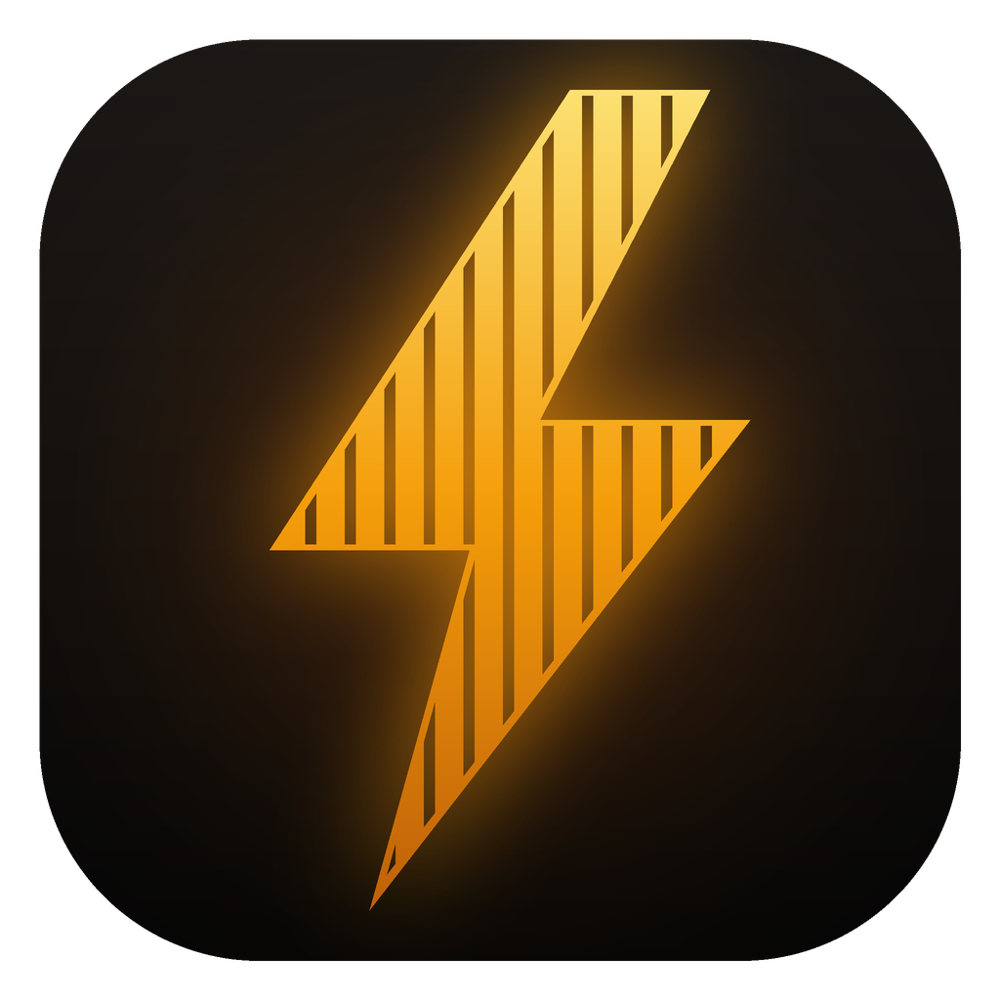
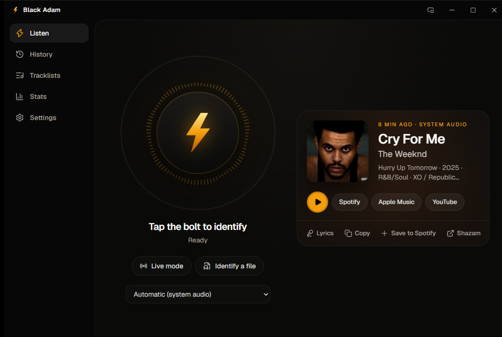

<p align="center">
  
</p>

<h1 align="center">Black Adam</h1>

<p align="center">
  Identify any song playing on your computer. Straight from system audio, no microphone, no account, no API key.
</p>

<p align="center">
  <a href="https://github.com/Adityasharma0101911/Black-Adam/actions/workflows/build.yml"></a>
  <a href="https://github.com/Adityasharma0101911/Black-Adam/releases"></a>
  
  <a href="LICENSE"></a>
</p>

<p align="center">
  
</p>

---

## Features

**Recognition**
- **System audio**: hears what your computer plays (Spotify, YouTube, games, streams). Windows uses WASAPI loopback, macOS 14.2+ uses a CoreAudio tap (no BlackHole needed), Linux uses PulseAudio/PipeWire monitor sources
- **Microphone mode**: pick a mic to identify songs playing in the room
- **Smart listening**: tries a match at 3, 6, 9 and 12 seconds and stops the moment it finds one
- **Identify a file**: drop an mp3, m4a, flac, wav, ogg or even a video onto the window
- **Live mode**: keeps listening and logs each new song once, backing off politely if Shazam rate-limits
- **Offline queue**: no internet? The recording is saved and identified automatically when you're back

**Results**
- Cover art, artist, album, year, genre and label
- 30-second preview playback
- **Synced lyrics** that follow the song in real time (via [LRCLIB](https://lrclib.net))
- One-click Spotify, Apple Music, YouTube and Shazam links
- **Save to Spotify**: adds the track to a private "Black Adam" playlist

**Everywhere**
- **Global hotkey** (default `Ctrl+Shift+B`) works even when the app is hidden
- **System tray** with Identify / Live mode, and close-to-tray
- **Notifications** when a song is found in the background
- **Mini player**: a small always-on-top bar
- **Launch at login**, quietly into the tray
- **Auto-update** from GitHub Releases (signed)

**Your music**
- Searchable **history** saved on your computer, exportable to CSV
- **Tracklists**: timestamped list of every song in a DJ set or stream, exportable to text
- **Stats**: top artists, genres, most identified songs and the last 14 days

**Streaming**
- **Discord status**: "Listening to <song>" on your profile
- **OBS overlay**: an animated now-playing card at `http://127.0.0.1:7777` for a Browser Source

## Download

Get the installer for your system from [Releases](https://github.com/Adityasharma0101911/Black-Adam/releases). Builds of every commit are also on the [Actions tab](https://github.com/Adityasharma0101911/Black-Adam/actions).

| Platform | File |
|----------|------|
| Windows 10/11 | `Black Adam_x.y.z_x64-setup.exe` or `.msi` |
| macOS 13+ (Intel and Apple Silicon) | `Black Adam_x.y.z_universal.dmg` (system audio needs macOS 14.2+) |
| Linux | `.AppImage`, `.deb` or `.rpm` |

## Optional integrations

| Feature | Setup |
|---------|-------|
| Save to Spotify | Create an app at [developer.spotify.com](https://developer.spotify.com/dashboard), add redirect URI `http://127.0.0.1:8898/callback`, paste the Client ID in **Settings → Spotify**, then **Connect** |
| Discord status | Create an application at [discord.com/developers](https://discord.com/developers/applications), paste its Application ID in **Settings → Streaming** |
| OBS overlay | Turn it on in **Settings → Streaming**, add `http://127.0.0.1:7777` as a Browser Source |

## Build from source

Requirements: [Rust](https://rustup.rs), Node.js 20+, and the [Tauri prerequisites](https://tauri.app/start/prerequisites/) for your OS (on Linux also `libpulse-dev` and `libasound2-dev`).

```bash
git clone https://github.com/Adityasharma0101911/Black-Adam.git
cd Black-Adam
npm install
npm run tauri dev      # run in development
npm run tauri build    # build installers into src-tauri/target/release/bundle
```

Tests:

```bash
cargo test --manifest-path src-tauri/Cargo.toml --lib
node --test src/lib/format.test.ts
```

### Releasing

1. Bump `version` in `package.json` and `src-tauri/Cargo.toml`.
2. Push a tag: `git tag v3.0.1 && git push --tags`.
3. The [Release workflow](.github/workflows/release.yml) builds Windows, macOS and Linux, signs the update files with the `TAURI_SIGNING_PRIVATE_KEY` secret and creates a draft release. Publish it and installed copies update themselves.

## How it works

1. **Capture**: [`cpal`](https://github.com/RustAudio/cpal) records the selected output (loopback) or microphone ([`audio.rs`](src-tauri/src/audio.rs)).
2. **Fingerprint**: the audio is resampled to 16 kHz mono and turned into a Shazam signature (spectral peaks across four frequency bands) ([`signature.rs`](src-tauri/src/shazam/signature.rs)).
3. **Match**: the signature is sent to Shazam's recognition endpoint and the response is parsed into a song ([`client.rs`](src-tauri/src/shazam/client.rs)).
4. **Show**: the React UI receives events from Rust (a 30 fps spectrum for the visualizer, results, errors) and renders them ([`src/`](src)).

## Tech stack

| Layer | Tool |
|-------|------|
| App shell | [Tauri 2](https://tauri.app) |
| Backend | Rust: cpal, realfft, symphonia, reqwest, tokio |
| Frontend | React 19, TypeScript, Vite, Tailwind CSS 4, Motion, Lucide icons, Geist font |
| CI | GitHub Actions + tauri-action |

## Project layout

```
src/                     React UI
  components/            bolt button + visualizer, song card, lyrics
  views/                 Listen, History, Tracklists, Stats, Settings
  lib/                   typed Rust commands, app state, formatting, updater
src-tauri/src/
  lib.rs                 app setup: commands, tray, hotkey, plugins
  listen.rs              listening loop, live mode, offline queue
  audio.rs               devices, loopback/mic capture, spectrum
  shazam/                signature generation + Shazam client
  decode.rs              audio/video file decoding
  store.rs               settings, history, queue (JSON in the app data folder)
  extras.rs              lyrics, Discord, OBS overlay
  spotify.rs             Spotify login + save to playlist
assets/                  icon source and generator
```

## Credits

The Shazam signature algorithm is adapted from [SongRec](https://github.com/marin-m/SongRec) by Marin M. (GPL-3.0). Lyrics come from [LRCLIB](https://lrclib.net). Black Adam is not affiliated with Shazam or Apple.

## Author

**Aditya Sharma**: [GitHub](https://github.com/Adityasharma0101911) · [Portfolio](https://adityasharma0101.vercel.app)

## License

[GNU GPL v3](LICENSE)
